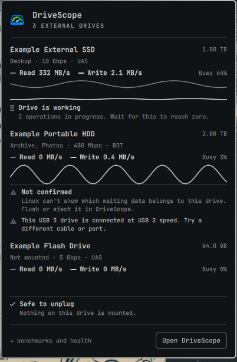

<picture>
  <source media="(prefers-color-scheme: dark)" srcset="data/brand/wordmark-dark-tight.png">
  
</picture>

Real-world speed and health of external drives, for Linux.

Most disk tools give you one score. DriveScope measures what the drive itself is doing, from the kernel's own counters, so cached speed can't pass as drive speed. Then it tells you what's holding the drive back, and whether it's safe to unplug.

It comes in two parts, and you can use either one or both:

| | Bar panel | App |
|---|---|---|
| **For** | A quick look during a transfer | Testing a drive, cable or port |
| **Shows** | Live speed and safe-to-unplug status | Benchmarks, health, history and detailed live graphs |
| **Runs on** | Omarchy | Arch and Omarchy, or other Linux with the packages installed |
| **Needs** | Nothing extra | GTK 4 and the packages `install.sh` adds |
| **Can it change a drive?** | No, it only reads system status | Only for what you approve: flush, eject and write tests |

## Bar panel



*Shown with simulated drives.*

```sh
omarchy plugin add https://github.com/thebenwalther/drivescope --enable
```

The logo appears on your bar, dimmed when no external drive is connected. During a transfer, the read and write speed appear beside it. Click it to see, for each drive:

- Read and write speed, how busy the drive is, and a graph of the last minute
- Which volumes are mounted, and the USB link speed and protocol
- A warning if the drive is connected slower than it should be, or using the older BOT protocol
- Whether it's safe to unplug

| Status | What it means |
|---|---|
| **Safe to unplug** | Nothing is mounted, it's mounted read-only, or no data is waiting to be written to any drive. |
| **Drive is working** | Operations are still in progress. Wait for them to finish. |
| **Not confirmed** | Data is waiting to be written somewhere on this computer, and Linux can't show whether it's for this drive. Flush or eject it in the app. |
| **Checking** | A drive or mount just changed, and the panel hasn't finished reading the new details. |

If the panel loses contact with its monitor, it stops showing any status rather than one that may be out of date.

To open the panel with a key, bind it to `omarchy-shell io.github.thebenwalther.drivescope toggle`. In the panel, Enter opens the app and Esc closes it. To hide the speed on the bar, turn off the plugin's **Show speed on the bar** setting.

The panel uses the system Python's standard library and `lsblk`, so there's nothing else to install. It reads `/proc`, `/sys` and `lsblk`, and never opens a drive. The **Open DriveScope** button appears once the app's packages are installed.

## App

### Install

If you already have the bar panel, install the app from the plugin's folder:

```sh
cd ~/.config/omarchy/plugins/io.github.thebenwalther.drivescope
./install.sh
```

Otherwise, clone it:

```sh
git clone https://github.com/thebenwalther/drivescope.git
cd drivescope
./install.sh
```

Then open DriveScope from your app launcher, or run `drivescope`.

`install.sh` asks for your password only if it needs to install missing packages: GTK 4, libadwaita, PyGObject, pycairo, `fio`, `smartmontools` and `udisks2`. On distributions without `pacman`, install those yourself first, and `install.sh` warns you about any that are missing.

The app runs from the folder you installed it from, so leave that folder in place. To update, run `git pull` there, or `omarchy plugin update` if it's the plugin's folder. If the icons changed, run `./install.sh` again.

### What it does

**Live.** Read and write speed, IOPS, latency, queue depth and busy time during any transfer, plus which of your processes are using the drive and whether it's safe to unplug. You can flush or safely eject from here.

**Benchmarks.**

- Sequential and random speed at different block sizes and queue depths, with the cache bypassed
- Sustained speed over time, which shows where a fast write cache runs out
- Batches of real small files, and a real copy from your internal drive
- Typical and worst-case latency (p50, p99, p99.9)
- A read scan across the whole drive
- An integrity check, with an optional fake-capacity mode that checks all free space
- A verdict on what's limiting the drive, with the evidence, or "no clear limit" when the data doesn't show one

**Health.** USB link speed and protocol, SMART data, and problems from the kernel log.

**History.** Results saved per drive, side-by-side comparison, CSV and JSON export, and an alert when a drive falls more than 20% below its usual speed at the same link speed.

### How it protects your data

- **It never writes to a raw device.** Write tests only create files inside a temporary `.drivescope-test-<id>` folder on a volume mounted read-write. The folder is deleted when the run finishes or is cancelled, and on the next launch after a crash.
- **System volumes are refused.** Write tests won't run on anything backing `/`, `/home` or `/boot`.
- **Shared volumes are refused.** Write tests won't run if other accounts can rename things in the volume's top folder (writable by others and not sticky). During a run, writes go through a handle to the test folder held open from the moment it's created, so renaming or replacing the folder can't redirect them.
- **Read-only volumes stay read-only.** You get read tests and monitoring only.
- **Write tests ask first.** They show the amount of data before starting, because writing uses up a small part of an SSD's lifespan.
- **The whole-drive scan can't write.** It uses a read-only file descriptor from UDisks2.

### Permissions

The app runs as your normal user. Two features ask for approval through polkit:

- **Whole-drive scan**, through UDisks2
- **Health data**, by running `smartctl`, which DriveScope only uses to read data

Tracking temperature during benchmarks means reading SMART data repeatedly, which would otherwise ask for approval every time. If you'd like to avoid that, `./install.sh --with-temperature` installs a policy that lets the person at the computer run `smartctl` without a password. It needs your password once to install.

Be aware that this applies to any program you run, and `smartctl` can also start self-tests or change SMART settings. It can't read or write files on a drive. [Remove](#remove) covers how to undo it.

### What the numbers mean

- **Queue depth:** how many requests are sent at once. Many drives only reach their top speed with several queued, so a tool that sends one at a time will see less.
- **IOPS:** separate operations completed each second. It matters most for many small files.
- **p50, p99, p99.9:** half of operations finished faster than p50, and only 1 in 100 or 1 in 1,000 took longer than p99 or p99.9. These show stutter that averages hide.
- **UAS and BOT:** USB storage protocols. UAS can queue requests. BOT is older and slower.
- **Unsafe shutdowns:** times the drive lost power without being shut down properly, often from unplugging without ejecting.

### Your results

Saved results live in `~/.local/share/drivescope/`, not in this repo. To keep your history on a new machine, copy that folder across.

## Limits

- Linux reports data waiting in RAM for all drives together, unless you're root. So "Safe to unplug" only appears when it can be shown. In the app, a flush is only trusted for 30 seconds. Ejecting is the only lasting guarantee.
- The process list covers your own processes, and its speeds cover all of a process's drive activity, so treat them as approximate.
- Some USB bridges don't pass SMART data through. DriveScope tries the known types and says so if none work.
- Temperature comes from SMART, so it isn't available on those bridges.
- FAT32 can't hold a 4 GB file, so tests there use just under that, and the fake-capacity mode can't cover all free space with one file. It says so in the results.
- Writing small files stops after a minute on slow drives, and reports how many it managed. FAT volumes are usually mounted with `flush`, which makes this test especially slow.
- On a setup with several monitors, each bar runs its own copy of the panel's monitor.

## Remove

If you installed the app, remove what `install.sh` added first:

```sh
rm -f ~/.local/bin/drivescope ~/.local/share/applications/dev.drivescope.DriveScope.desktop
rm -f ~/.local/share/icons/hicolor/*/apps/dev.drivescope.DriveScope*.png
sudo rm -f /usr/share/polkit-1/actions/dev.drivescope.smartctl.policy  # only if you used --with-temperature
```

Then remove the bar panel, or delete your clone if you installed the app that way:

```sh
omarchy plugin remove io.github.thebenwalther.drivescope
```

Your saved results stay until you delete `~/.local/share/drivescope/`. The packages `install.sh` installed also stay, since other software may need them.

## Development

```sh
/usr/bin/python3 -m unittest
```

Use the system Python, since GTK's bindings may not be available to one from a version manager.

`drivescope --include-internal` also lists internal and loop drives, which is useful for testing write tests against a disk image.

## License

[MIT](LICENSE)
